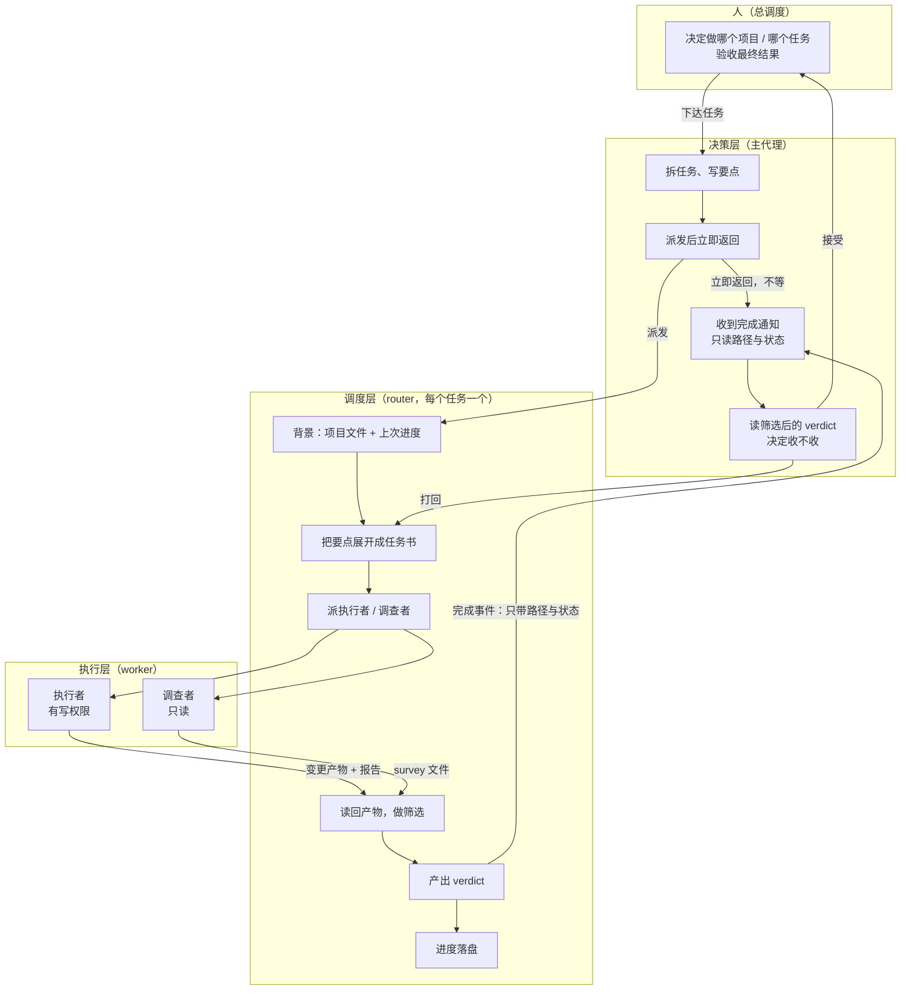
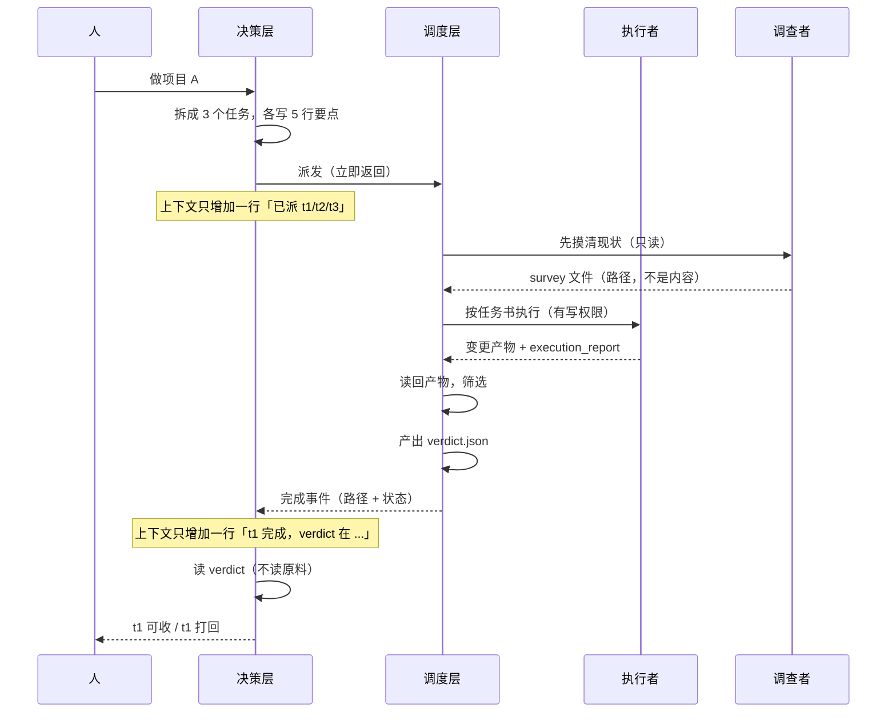
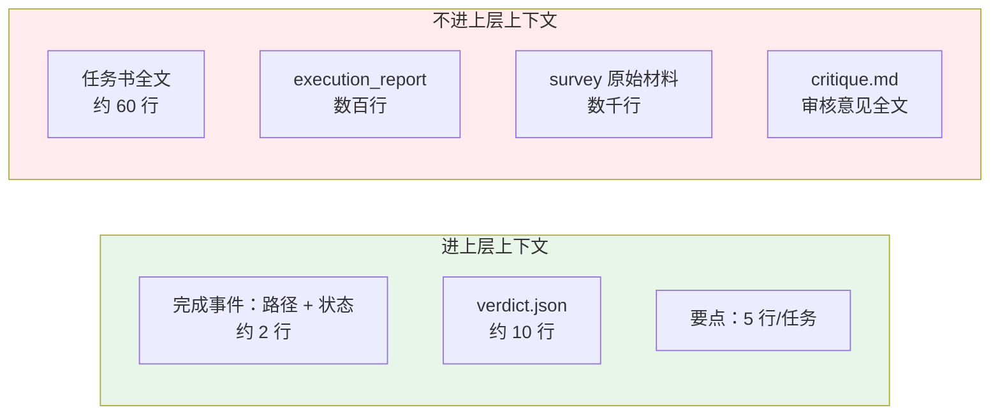
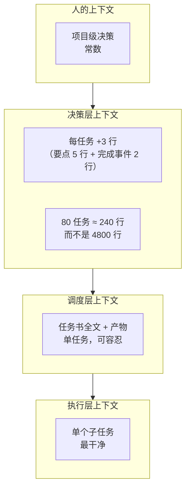
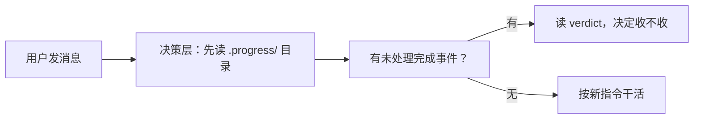

# 三层委派框架

> 一张图说明「人 → 决策层 → 调度层 → 执行层」怎么流转。
> 核心约束：**原料不进上层上下文，只传路径与判决。**

---

## 总览

---

## 一次完整流转

---

## 上下文边界（这张图最重要）

**判据：上层只需要「决定收不收」所需的信息。**
决定收不收，需要的是路径、状态、判决。不需要过程。

---

## 三个角色各自的上下文成本

**越往下，上下文越宽；越往上，越窄。**

---

## 关键机制在 DSH 里对应什么

| 框架里的环节 | DSH 机制 | 状态 |
|---|---|---|
| 派发立即返回 | `subagent` 工具返回 child id 立刻返回 | ✅ 原生 |
| 完成通知异步到达 | `Parent delivery emits its notice after settlement` | ✅ 原生 |
| 完成只带路径 | 子代理最终回复留空 / 只回 `✓` | ✅ 需约束 |
| 原料不进上下文 | 子代理写文件，不回内容 | ✅ 需约束 |
| 跨 session 接续 | 进度落盘到项目文件 | ✅ 靠约定 |
| **hook 补投摘要** | ❌ 无此机制 | ⚠️ **需替换** |
| **notify-hub 唤醒** | ❌ 无此机制 | ⚠️ **需替换** |
| **worker 独立进程** | ❌ 子代理在进程内 | ⚠️ **需接受** |

---

## 三个需要替换的机制，怎么替代

### 1. 没有 `UserPromptSubmit hook` → 用「开工先读进度」

**不靠钩子，靠「开工第一步固定动作」。** 写进 persona 即可。

### 2. 没有 `notify-hub` → 完成通知本身就是通知

源码：`Parent delivery emits a user-role status notice`

**子代理一完成，主代理自动收到通知。** 不需要额外的唤醒机制。

**但要注意**：通知内容 = 子代理的最终文本。所以**必须让子代理闭嘴**，否则通知会很大。

### 3. worker 不是独立进程 → 接受，并控制并发

`dsh-subagent-spawn-in-process`：所有子代理在同一个 Node 进程。

**后果**：不能真的「独立进程 + 长连接」。并发上限是 `maxActiveSubagents`（当前 24），
瓶颈先出现在内存和 API 速率，不在进程数。

---

## 落地检查清单

一个任务从派发到收尾，逐项确认：

- [ ] 要点写了 5 行（做什么 / 路径 / 验收命令 / 禁止范围）
- [ ] 调度层的任务书里写了「禁止 send_message」
- [ ] 调度层的任务书里写了「最终回复只回 `✓`」
- [ ] 产物路径明确（`tasks/<id>/`）
- [ ] 进度落盘（`.progress/<id>.json`，含状态与路径）
- [ ] 完成事件只带路径与状态，不带内容
- [ ] 决策层读的是 `verdict.json`，不是原料
- [ ] 打回时带上 `critique.md` 路径，不是内容

